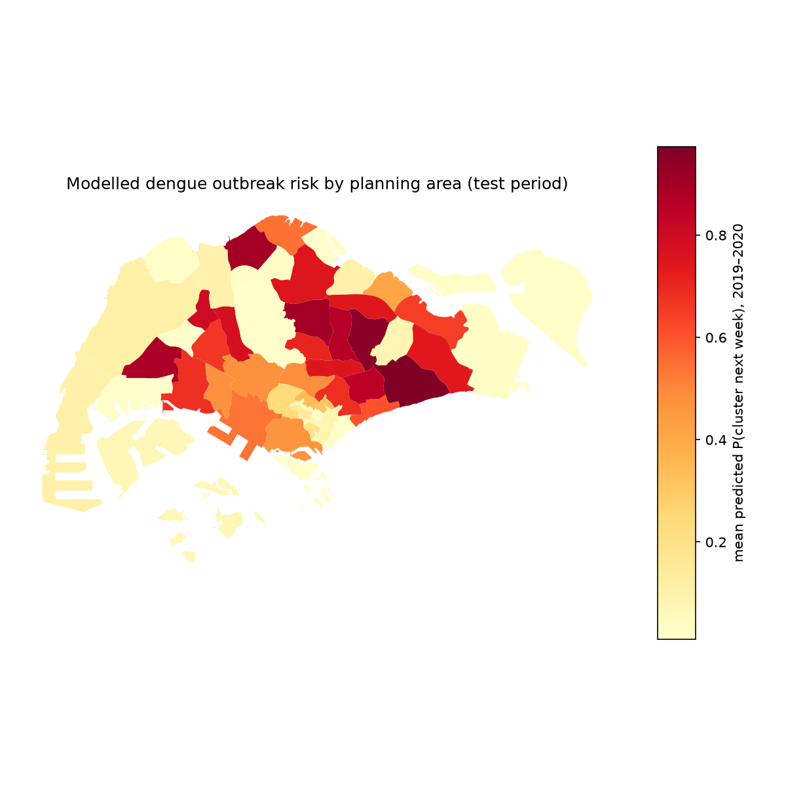
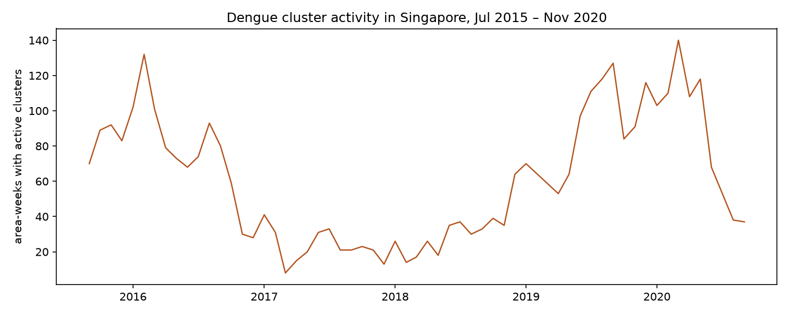
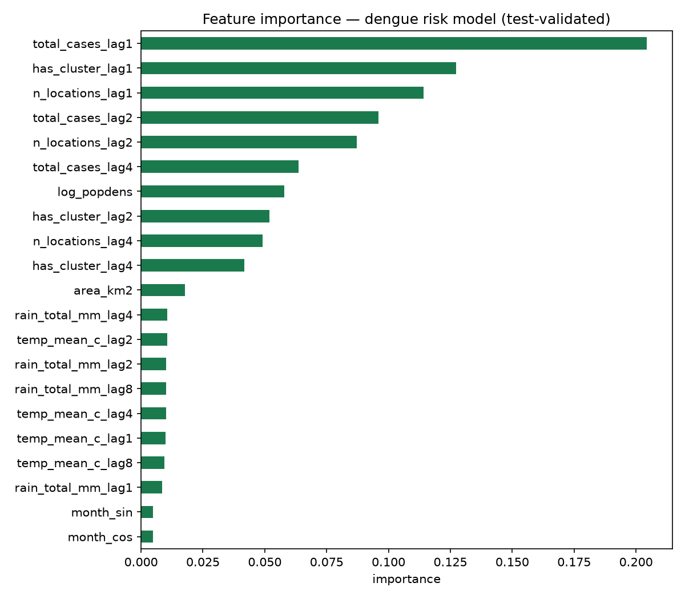

# Dengue Outbreak Risk Mapping — Singapore

Weekly dengue-outbreak risk scores for Singapore's 55 planning areas, learned
from 5 years of NEA cluster surveillance, weather, and population data.
Given this week's conditions, which planning areas are most likely to have an
active dengue cluster **next week**?



> **Honesty note.** This is a *screening* model, not an operational forecast.
> Labels come from documented cluster locations (see *Data*), not confirmed
> case counts; the model leans heavily on recent cluster history (as any
> honest near-term disease model does). See *Limitations*.

## Problem

Dengue is endemic in Singapore, with major outbreaks in 2013, 2019 and 2020
(the 2020 outbreak exceeded 35,000 reported cases). The National Environment
Agency (NEA) publishes active cluster locations, but a forward-looking,
area-level risk view helps prioritize vector-control inspections *before*
clusters grow. This project asks: can weather lags, recent cluster history,
and population density predict next week's cluster presence per planning area?

## Data

| Data | Source | Accessed | Notes |
|---|---|---|---|
| Dengue cluster snapshots (256 weeks, 2015-07-03–2020-11-06; 56,976 cluster-location records) | [outbreak.sgcharts.com/data](http://outbreak.sgcharts.com/data) (NEA-sourced, weekly) | 2026-10-07 | Each row = one cluster location (lat/lon, case counts). sgcharts notes the CSVs are best-effort PDF conversions — dirty addresses possible. |
| Current NEA dengue clusters (GeoJSON) | [data.gov.sg](https://data.gov.sg) dataset `d_dbfabf16158d1b0e1c420627c0819168` (NEA) | 2026-10-07 | Daily snapshot; used for reference, not training. |
| Planning-area boundaries (55 areas) | [data.gov.sg](https://data.gov.sg) dataset `d_4765db0e87b9c86336792efe8a1f7a66` (URA Master Plan 2019) | 2026-10-07 | |
| Resident population by planning area | [data.gov.sg](https://data.gov.sg) dataset `d_ae8f6f7e9184361a187dd335fa04b684` (Dept. of Statistics) | 2026-10-07 | 6 non-residential areas report `na` → treated as 0. |
| Weather (daily temp/rainfall → weekly) | [Open-Meteo](https://open-meteo.com) ERA5 archive (no key) | 2026-10-07 | MSS's data.gov.sg v1 API returns no data before 2018, so ERA5 reanalysis covers the full 2015–2020 window. Island-wide weekly aggregates (Singapore ≈ 50 km). |

Singapore Open Data Licence v1.0 applies to the data.gov.sg datasets; sgcharts
data is NEA-sourced via sgcharts (cite both). ERA5 via Copernicus/Open-Meteo.

## Method

**Unit:** planning area × ISO week (55 × 247 weeks = 13,585 rows; 27.7% positive).

**Labeling rule:** `has_cluster = 1` if ≥1 active cluster location falls inside the
planning area that week (point-in-polygon on URA boundaries; 0 points fell
outside all areas). **Target:** `has_cluster` in week *t+1*.

**Features (all from week ≤ t — no leakage):**
- Weather lags 1/2/4/8 weeks: weekly rainfall total, mean temperature
  (dengue responds to weather with delay: rain → breeding sites → mosquito
  development + extrinsic incubation → cases)
- Prior activity lags 1/2/4 weeks: cluster presence, location count, case count
- Static: log population density, area size
- Seasonality: cyclical month encoding

**Validation:** strict time split — train 2015-07–2017-12, validation 2018
(model selection), test 2019-01–2020-11 (reported once). RandomForest
(n=400) selected over gradient boosting on validation AUC, refit on
train+validation.

## Results (test set, n=3,740 area-weeks, 44.5% positive)

| Metric | Value |
|---|---|
| ROC AUC | **0.945** |
| Average precision | 0.938 |
| Precision @ 0.5 | 0.905 |
| Recall @ 0.5 | 0.775 |
| F1 @ 0.5 | 0.835 |

**Ablation** (lag-1 persistence features removed — measures emerging-risk
signal from weather/history/static alone): AUC **0.936**, F1 0.805. The model
is not just echoing last week.

**Ecology sanity checks** (all from real data):
- Warmer weeks precede higher risk: mean lagged temperature 27.15 °C before
  positive weeks vs 27.05 °C before negative weeks (positive correlation) —
  consistent with *Aedes* biology.
- Population density is the strongest static predictor (corr 0.45) — dengue
  is an urban disease; dense estates (Bedok, Hougang, Tampines) top the risk
  ranking.
- Rainfall shows ~zero linear correlation at these lags — consistent with
  Singapore literature (year-round rain; heavy downpours can flush breeding
  sites).

Top-5 riskiest planning areas (mean predicted P, test period): Bedok 0.97,
Hougang 0.95, Ang Mo Kio 0.90, Woodlands 0.90, Jurong West 0.88.




## Limitations

1. Labels are *documented cluster locations*, not validated case counts; the
   sgcharts CSVs are best-effort conversions of NEA PDFs (their own
   disclaimer: wrong/misspelled/duplicate addresses possible).
2. Persistence dominates: clusters last weeks, so recent history is the
   strongest predictor. The ablation shows real additional signal, but this
   will not catch outbreaks with no local precedent.
3. Weather is island-wide ERA5, not station-level MSS data (MSS v1 has no
   pre-2018 history); micro-climates are not resolved.
4. Planning areas are coarse; block-level risk would need finer data.
5. 2020 was an exceptional outbreak year — test performance partly reflects
   strong, persistent signals that year.

## Reproduce

```bash
python -m venv .venv && source .venv/bin/activate
pip install -r requirements.txt
python src/get_data.py        # fetch raw sources (skips existing)
python src/fetch_weather.py   # Open-Meteo ERA5 -> data/weather_weekly.csv
python src/build_panel.py     # snapshots -> data/panel_weekly.csv
python src/features.py        # -> data/modeling.csv
python src/train.py           # -> outputs/metrics.json + charts + risk map
```

## Layout

```
src/            get_data.py, fetch_weather.py, build_panel.py, features.py, train.py
data/           raw + derived tables (see get_data.py for provenance)
outputs/        metrics.json, risk_map.png, planning_area_risk.geojson/.csv,
                seasonality.png, feature_importance.png, rf model not stored
                (retrain via train.py; seed=42)
```

## Attribution

Cluster history: National Environment Agency via
[outbreak.sgcharts.com](http://outbreak.sgcharts.com/data). Boundaries: Urban
Redevelopment Authority via data.gov.sg. Population: Dept. of Statistics via
data.gov.sg. Weather: ERA5 (Copernicus) via Open-Meteo. This is an independent
portfolio project; no agency endorses it.
